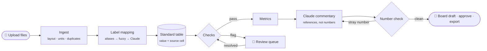

<div align="center">

# Portfolio KPI Intake & Board Report Assistant

**Turn messy portfolio-company spreadsheets into validated metrics and a board-ready draft in minutes, with every number traceable to its source cell.**


</div>

---

## Why it exists

Every month, each company in an investment portfolio sends its KPIs in its own format: different labels, units, layouts, and the occasional mistake. Before anyone can compare companies or prepare a board meeting, an analyst has to clean and check every file by hand and then write the commentary.

This assistant does that work. It reads each file as submitted, checks it, and computes the SaaS metrics investors track. It then drafts the board commentary. Analysts only review the items the tool flags instead of rechecking every spreadsheet, and deal leads get numbers they can trust.

> **Code does the numbers. Claude does the words. A person approves the result.**

## Who it helps

| | |
| --- | --- |
| 📊 **Portfolio analysts** | One clean, comparable table across every company, plus a short list of exactly what needs checking |
| 💼 **Deal leads & investors** | Board commentary where every figure links back to the file and cell it came from |
| 🧾 **Company CFOs** | Specific follow-up questions ("July ending ARR doesn't reconcile") instead of vague back-and-forth |

## Features

- **Reads any layout.** Handles Excel and CSV, months as rows or as columns, header rows buried under logos, one tab per quarter, $K or $M, and decimals or percentages.
- **Smart label matching.** Matches "Annual Recurring Rev", "Logos", and "Lost Customers ARR" to standard metrics through an alias table, then fuzzy matching, then Claude. Each confirmed match is learned, so the next file with that label needs no review.
- **Automatic validation.** Runs ARR rollforward, month-to-month continuity, completeness, plausible-range, and duplicate-file checks on every company and month.
- **Human-in-the-loop review queue.** Anything that fails a check is sent to a person with its file, cell, and reason. Nothing is guessed. Resolving an item updates the metrics and the draft right away.
- **SaaS metrics.** Calculates ARR growth, net and gross revenue retention, churn rate, gross margin, and ARR per employee.
- **AI board commentary you can trust.** Claude writes the narrative but cannot type numbers. Every figure is placed by code and linked to its source cell, and any draft with a number that has no source is rejected and regenerated.
- **Safe with untrusted files.** Spreadsheet contents are always treated as data, so a cell saying "ignore previous instructions" is flagged instead of followed.
- **Audit trail built in.** Saves every upload, decision, approval, and Claude call, so any approved draft can be traced back to its inputs.
- **One-click export.** Download the approved board draft as an editable Word document.

## Architecture



Every file is converted into one standard long table, and each value keeps its source file and cell all the way to the final report:

```
company | month | metric | value_usd_k | source_file | source_cell
```

**Design principles**

- **One entry point.** `pipeline/run.py` takes files in and returns results. The dashboard calls it today, and a SharePoint or Power Automate trigger could call it tomorrow without any changes.
- **Workflow, not agent.** The steps are fixed, so board numbers come out the same on every run.
- **AI where it helps.** Claude only matches unfamiliar labels and writes prose. Every calculation is plain, tested Python.
- **Pluggable notifications.** Alerts go through a small `Notifier` interface: console now, Teams later.

## Tech stack

| Layer | Tools |
| --- | --- |
| Language | Python 3.11+ |
| Data processing | pandas, openpyxl (cell-level source tracking) |
| Label matching | PyYAML alias table, rapidfuzz |
| AI | Claude API with structured JSON output |
| Dashboard | Streamlit (multipage) |
| Export | python-docx |
| Testing | pytest |

## Getting started

**1. Install**

```bash
git clone <repo-url>
cd Portfolio_KPI_Intake_and_Board_Spec_Assistant
python -m venv .venv && source .venv/bin/activate
pip install -r requirements.txt
```

**2. Add your Claude API key** (needed only for label suggestions and commentary)

Create a `.env` file in the repo root:

```bash
ANTHROPIC_API_KEY=sk-ant-...
CLAUDE_MODEL=claude-sonnet-5-5   # optional
```

**3. Launch the dashboard**

```bash
streamlit run app.py
```

Sample files for five fictional companies are in `data/raw/`. Upload them to see the full workflow.

## How it works in the app

| Page | What you do |
| --- | --- |
| **⬆️ Upload** | Drop in the month's Excel and CSV files. The whole pipeline runs automatically. |
| **📈 Overview** | See every company at a glance: ARR, growth, retention, churn, margin, and whether it's ready or needs review. |
| **🔍 Review queue** | Confirm or reject each flagged item, and ask Claude to suggest matches for unfamiliar labels. |
| **📝 Board draft** | Generate the commentary, click any figure to see its source, approve the draft, and export it to Word. |

## Project structure

```
app.py                  Dashboard home (portfolio overview)
pages/                  Upload, Review queue, Board draft
dashboard/              View logic, uploads, Word export, approvals
pipeline/
  run.py                Single entry point: files in → results out
  ingest.py             Layout detection, units, duplicates
  mapping.py            Alias + fuzzy label matching
  label_match.py        Claude label suggestions
  checks.py             Validation rules → review queue
  metrics.py            SaaS metric calculations
  commentary.py         Claude draft + number check
  review.py             Review loop and audit trail
integrations/notify.py  Notification interface
eval/                   Scoring against an answer key
tests/                  pytest suite
docs/                   Project spec
data/raw/               Sample (fictional) input files
```

---

<div align="center">
<sub>All companies and figures in the sample data are fictional.</sub>
</div>
